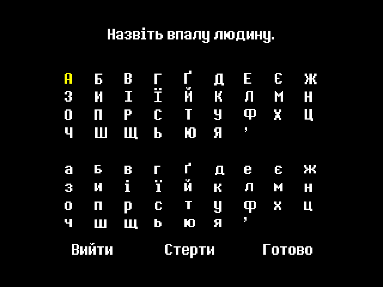
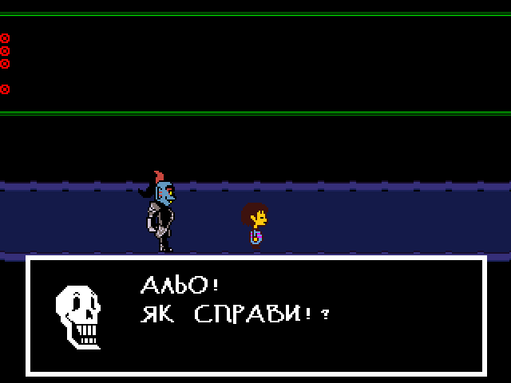
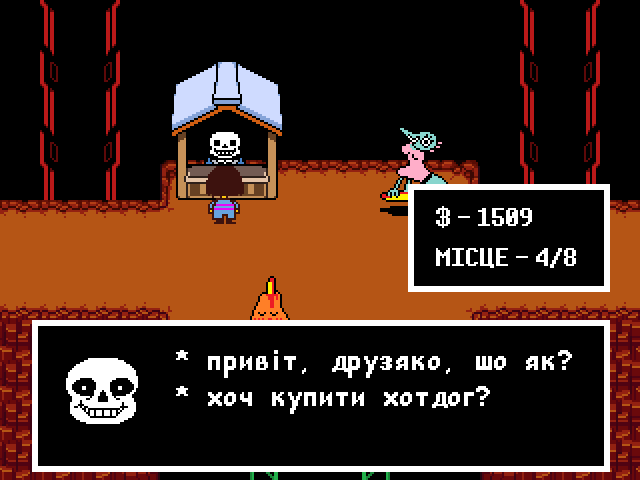

# Новий українізатор для гри Undertale!
Ця модифікація, як не дивно, додасть солов'їну мову та багато інших цікавих речей, які вам точно сподобаються.

(Не плутати з перекладом Undertale на Толоці.)

<details>
<summary><ins>Приклади перекладу:</ins></summary>








</details>

## Особливості перекладу


Завжди хотіли пожертвувати купу віртуальних грошей богоподібному Тобі Фоксу, або відгамселити Скажену Нявкалку всередині височенної раковини Папайруса, але у вас є лише комп'ютер і смартфон? Нині ваш шанс здійснити свою мрію, ще й українською!

| | |
|---|---|
||**Рамки**<br><br>Завдяки ним ігровий досвід на екрані роздільністю 16:9 буде набагато приємнішим! Обирайте, які вам до вподоби:<br>**Динамічні** — такі рамки підлаштовуються під локацію, в якій ви перебуваєте.<br>**Статичні** — звичайні рамки з гарним візерунком, які будуть супроводжувати вас протягом всього проходження.<br>**Мінімалістичні** — як зрозуміло з назви, нічого зайвого.|
<details>
<summary><ins>А чого вам зуби заговорювати? Краще  раз побачити, ніж сто разів почути!</ins></summary>


</details>


| | |
|---|---|
||**Повідомлення про від'єднаний контролер**<br><br>Якщо під час гри ваш ґеймпад розрядився, або ви його від'єднали, гра автоматично стає на павзу та пише щось цікавеньке!<br>`(Стандартно ця особливість вимкнена)`|


| | |
|---|---|
||**Собача святиня**<br><br>Найсвятіше, найкрасивіше та найкорисніше місце у всій грі.<br>Віддавайте всі свої накопичення на розвиток святині та станьте повноцінними послідовниками собачої віри!<br>І пам'ятайте: Надокучливий собака піклується про вас!<br>`(Очевидна брехня)`|


| | |
|---|---|
||**Скажена Няв-Няв**<br><br>Новий секретний мінібос із популярного у підземеллі аніме “Няв-Няв: Цьомка-Няшка” тепер на вашому пристрої!<br>Хай щастить.|


| | |
|---|---|
||**Собаче казино**<br><br>Стривайте, це що... Азартна залежність у моїй грі для всієї сім'ї?<br>ЩЕ Б ПАК!<br>Виграйте унікальні винагороди для справжніх ҐЕЙМЕРІВ або програйте всі свої накопичення слот-машині чи, можливо, Сансу в покер.|


+ **Жодного Google Translate** \
Їй-богу, перекладати таку гру *гугл перекладачем* якось взагалі не папайрусно. Тому кажемо оревуар дурнуватому перекладачу і більше ніколи про нього не згадуємо!
+ **Більший розмір вікна гри** \
Гра більше не буде мікроскопічною, адже розмір її вікна автоматично підлаштовуватиметься під розмір вашого екрана!
+ **Різні платформи** \
Локалізація доступна не лише на Windows, а ще й на Linux, Mac, Android та PS Vita!
+ **Підтримка контролерів** \
Локалізація має власну підтримку ґеймпадів, тож для гри з ними вам не потрібне введення Steam, додаткові програми та інші танці з бубном!\
Під контролер також можна налаштувати кнопки, їхній стиль і чутливість стіків\
*```P.S. Через застарілість рушія UNDERTALE керування контролерами PS5 потребує додаткової ручної конфігурації кнопок дій у меню “Ґеймпад” параметрів гри або ввімкнення введення Steam.```*
+ **Швидкий пропуск тексту (також відомий як “Захисник зап'ястя”)** \
Особливість із DELTARUNE, що дозволяє миттю пропускати текст, затиснувши кнопку <kbd>ігрового меню</kbd>.\
Корисна для ваших перепроходжень або спідранів!
+ **Примусова поява Перепрошую** \
Можливість миттєво натрапити на цього ворога в Жаркраї без очікувань на певну дату та час.
+ **Коментарі Меттатона** \
Під час свого мюзиклу Меттатон коротко коментує танок головного героя.
+ **Нагороди з консолей** \
Виконуйте цікаві завдання та отримуйте за це призи (вони ж “досягнення”)!\
*```P.S. Повноцінно вони працюють лише на Android (Досягнення в Google Play) та Vita. У локалізації на інших ОС — суто косметичні й ніяк не впливають на ваш профіль у клієнтах ігрових сервісів.```*
+ **Переозвучення Меттатона** \
Невикористане, давно записане українське озвучення аудіокліпів Меттатона, яке не потрапило до локалізації на момент її релізу 2025 року, проте тепер його можна почути просто в грі!\
...якщо ви цього, звісно, захочете.

Новини та оголошення
---
|***22 листопада 2026***||
|:---|---|
|**Українська локалізація UNDERTALE — Оновлення v1.0.1.35-beta/v1.0.5-lite/v1.6-A**<br>7 листопада вийшло це оновлення, доступне для завантаження **на всіх сторінках локалізації**, а не тільки в LBK Launcher. Також воно нарешті доступне на *Android* і *PS Vita*!!<br>З часом ми випустимо ще одне, вже заключне оновлення локалізації, а поки зичимо всім приємної гри! UwU **<p align="right">— Pereclaw**|

<details>
<summary><ins>Минулі пости</ins></summary>

|***21 серпня 2026***||
|:---|---|
|Відтепер це оновлення (v1.0.1.11) в [LBK Launcher](https://lbklauncher.com/games/undertale/pereclaw-localization), окрім Windows, також доступне для встановлення на ***MacOS*** і ***Linux***!!!<br>І не лише для власників копії гри в Steam, але також GOG і Microsoft Store!!<br>Тепер ми займемося його портуванням на Android і PS Vita! ^ ^ **<p align="right">— Pereclaw**|


|***16 серпня 2026***||
|:---|---|
|**Українська локалізація UNDERTALE — Оновлення v1.0.1.11**<br>Оновлена, тестова версія (1.0.1.11) української локалізації Undertale відтепер доступна для встановлення в [LBK Launcher](https://lbklauncher.com/games/undertale/pereclaw-localization) (наразі лише) на Windows!<br><br>Ця версія містить невеликі нововведення, виправлення сотень різних помилок у тексті, де-не-де покращення якості перекладеного, а також лагодить різні неприємні баґи, зокрема ті, що пов’язані з “Додатковими параметрами” локалізації.<br><br>Вихід цього оновлення на решту підтримуваних ОС буде невдовзі!**<p align="right">— Pereclaw**|

---
#### 25 червня 2025
**Українська локалізація UNDERTALE — Реліз (v1.0)**

**Що нового:**
* Повний переклад повноцінної версії гри **UNDERTALE!!!**
* Переклад працює на **Windows, Linux, Maс, Android і PS Vita!!**
* Консольні ексклюзиви!
* Додаткові параметри!
* LITE версія.

Детальніше про них, різницю в локалізації між різними ОС, а також відповіді на ЧаПи читайте в нещодавньому [довгочиті ПОСТУПУ](https://pereclaw.nekoweb.org/postupy/summer25/).
(Для найкращого відображення сторінки радимо переглядати її з ПК або у вебверсії “для комп'ютера”)
**<p align="right">— Pereclaw**

</details>

---

# Автори
**Над українською локалізацією працювала спілка “Pereclaw”**\
<a href="https://discord.gg/uBMDfeMDJ3"></a>
<a href="https://www.youtube.com/@pereclaw"></a>
<details>
<summary><ins>Список тих, хто доклався до перекладу:</ins></summary>
<h3>Організатор</h3>
<ol>
    <li type="disc"><a href="https://github.com/Roavello">Andrew "Roavello" Camomile</a><br>
</ol>
<h3>Перекладачі</h3>
<ol>
    <li type="disc"><a href="https://github.com/Roavello">Andrew "Roavello" Camomile</a><br>
    <li type="disc"><a href="https://github.com/DanielleTlumach">DanielleTlumach</a><br>
    <li type="disc"><a href="https://github.com/yanchukcha">yanchukcha</a><br>
    <li type="disc">x1ki_<br>
    <li type="disc"><a href="https://discord.com/users/246731296435470337">Sandwick</a><br>
    <li type="disc"><a href="https://discord.com/users/509078768288137236">Chiromy</a><br>
    <li type="disc"><a href="https://discord.com/users/493110908424421377">BoneKiller</a><br>
    <li type="disc"><a href="https://discord.com/users/529280743705149452">pita_guy</a><br>
</ol>
<h3>Редактори</h3>
<ol>
    <li type="disc"><a href="https://discord.com/users/1003288266587521094">Chlorine</a><br>
    <li type="disc"><a href="https://github.com/DanielleTlumach">DanielleTlumach</a><br>
    <li type="disc"><a href="https://github.com/yanchukcha">yanchukcha</a><br>
    <li type="disc"><a href="https://discord.com/users/529280743705149452">pita_guy</a><br>
    <li type="disc"><a href="https://discord.com/users/341277267567181835">silly_garlic</a><br>
    <li type="disc"><a href="https://discord.com/users/565975326451171363">shultz42</a><br>
    <li type="disc"><a href="https://discord.com/users/458535829753561099">perishrad</a><br>
</ol>
<h3>Озвучення</h3>
<ol>
    <li type="disc">Квітик — <a href="https://discord.com/users/565975326451171363">pita_guy</a><br>
	<li type="disc">Меттатон — <a href="https://www.youtube.com/@SeriousDamir">SeriousDamir</a><br>
</ol>
<h3>Особлива подяка</h3>
<ol>
    <li type="disc">Наші улюблені тестери<br>
    <li type="disc"><a href="https://github.com/marklangerhacker">Mark L.</a><br>
    <li type="disc"><a href="https://github.com/ytrav">Maeve</a><br>
    <li type="disc"><a href="https://discord.com/users/569481225148956672">foalex</a><br>
    <li type="disc"><a href="https://x.com/skolomyikosh">Мигаль Кушницькый</a><br>
    <li type="disc"><a href="https://github.com/danielah05/UndertaleDecomp">Vultumast та Daniela за Undertale Decompilation</a><br>
    <li type="disc"><a href="https://gamejolt.com/games/undertale-android/726064">Booker Dev за Мобільний порт Undertale</a><br>
	<li type="disc"><a href="https://github.com/yanchukcha">yanchukcha</a> і <a href="https://discord.com/users/373903086529544202">Омега</a> за пострелізні виправлення в коді<br>
</ol>
</details>
<br>

Куточок запитань (ЧаПи)
---
")

### П: Для якої версії гри ця локалізація?
В: UNDERTALE 1.08

### П: Із якої мови виконано переклад?
В: Із мови оригіналу, себто англійської, з оглядом на офіційну японську локалізацію.

### П: Де можна завантажити локалізацію?
В: Там же, де й перекладене UNDERTALE DEMO, — у [Releases](https://github.com/Pereclaw/undertale-ua/releases), на [KULI](https://kuli.com.ua/undertale#translations) або [Nexusmods](https://www.nexusmods.com/undertale/mods/12?tab=files).

### П: Як встановлюється ця локалізація?
В: Патчем через Delta Patcher, тому з піратською копією гри вона не працюватиме.
<br>Посилання на інструкції з її встановлення на кожну з доступних ОС є в описі кожного [релізу](https://github.com/Pereclaw/undertale-ua/releases).

### П: У яких крамницях можна придбати гру, щоб на неї ставилась локалізація?
В: Локалізація сумісна з копіями гри, придбаними в [Steam](https://store.steampowered.com/app/391540/Undertale/), [GOG](https://www.gog.com/en/game/undertale) або [Крамниці Microsoft](https://www.xbox.com/en-us/games/store/undertale-pc/9n046hwgq4j2).

### П: У мене не відкривається Delta Patcher. Що робити?
В: Спробуйте [онлайн патчер](https://www.marcrobledo.com/RomPatcher.js/).
<br>Процедура застосування патчів ідентична.
<br>Перед або після завантаження пропатченого файлу в теку гри не забудьте прибрати з його назви “<ins> (patched)</ins>” (разом із відступом).

### П: Я можу продовжити своє старе збереження з цим перекладом, чи гру треба починати з початку?
В: Так, ви можете продовжити зі своїх старих збережень, навіть після встановлення оновлення локалізації.

### П: У мене пройдена демоверсія гри з вашим перекладом. Чи підтягне мій прогрес з неї повна версія гри, як це робить DELTARUNE?
В: На жаль, ні. Зі слів Тобі Фокса, DEMO він створював на старезному ПЗ із зовсім іншими спроможностями.

### П: Чи можу я продовжити своє збереження у грі без перекладу?
В: Так, можете. Єдине, що локалізація вносить від себе в збереження — ім'я гравця українською.

### П: Чи можна поставити мод [назва моду] на гру з перекладом?
В: На жаль, ні, адже більшість модифікацій ставляться на data файл гри, і наша локалізація теж, тому будь-який інший мод просто перекриє її або не встановиться.

### П: Чи зробите ви локалізацію гри на інші ОС? Наприклад, Nintendo Switch або PlayStation 4?
В: Ні, оскільки для цього перекладачам, а потім і гравцям довелося б зламувати свої приставки, що є порушенням їхньої “Угоди користувача” або “Умов обслуговування”.

### П: Чому ж тоді ви зробили переклад гри на PlayStation Vita?
В: Тому що ця приставка, на відміну від тих двох, офіційно більше не підтримується й не обслуговується. Також на Vita вже неможливо легально придбати ні цифрову копію гри, ні її фізичне видання.

### П: Чи зможу я отримувати колекційні картки гри в Steam, поставивши цю локалізацію?
В: Так, зможете. Наша локалізація не впливає на взаємодію гри із клієнтом Steam.

### П: Куди краще звертатися, якщо під час гри з перекладом мені трапиться баґ або текстова помилка?
В: Якщо маєте питання щодо локалізації, знайшли помилку або баґ — просимо звертатися з цим на нашому Discord-сервері DR/UT Україна в каналі “#дискусії-перекладів” чи “#баґи-та-критика”.
<br>   Також ви можете відправити листа на імейл utdr.ukrloc.pereclaw@gmail.com.

## UNDERTALE DEMO

### П: У DEMO працюють контролери?
В: Ні, однак під нього можна налаштувати введення свого контролера у Steam, попередньо додавши застосунок демоверсії у свою бібліотеку ігор, або ж завантажити та налаштувати програму JoyToKey.


## 

### Attribution 4.0 International

<a rel="license" href="http://creativecommons.org/licenses/by/4.0/">

</a>
<br />
This work is licensed under a <a rel="license" href="http://creativecommons.org/licenses/by/4.0/">Creative Commons Attribution 4.0 International License</a>.
